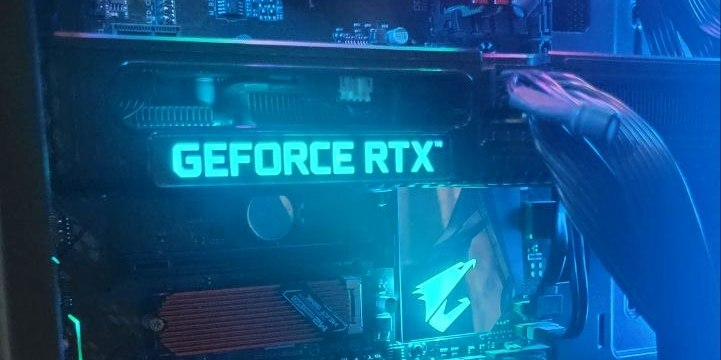
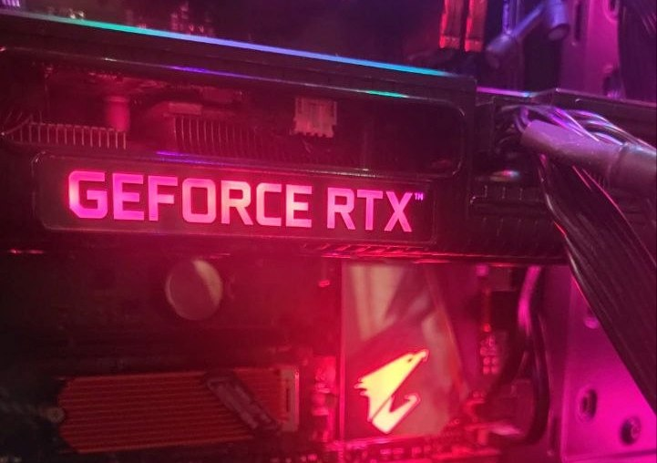
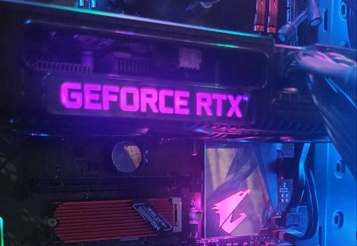

# AmbilightRGB

**English** | [Русский](README_RU.md)

Screen-synced ambient RGB in ~100 lines of math. No AI. **5 FPS**, near-zero GPU/CPU cost, all OpenRGB devices painted every frame.

Windows · Python 3.10+ · [OpenRGB](https://openrgb.org/) SDK · MIT

### Why this exists

You do not need AI, ML, or edge detection for background Ambilight. A downsampled screen grab, chroma-weighted mean RGB (whites/greys/blacks filtered out), and exponential smoothing at **5 FPS** keep the glow in sync with the picture while using **~0% GPU** and a tiny CPU footprint. OpenRGB then broadcasts one `RGBColor` to every device — motherboard ARGB, coolers, and the GPU alike.

On empty or achromatic frames (loading screens, black scenes, full white), the target fades to a calm muted blue instead of freezing on the last random color. If the OpenRGB socket drops, the script waits and reconnects on its own.

### Hidden GPU RGB unlock

Many GPUs (for example **Palit RTX 3060 Dual**) look “stuck” on a single white / unmanaged color in:

- the vendor tool (**ThunderMaster**), and
- the OpenRGB **GUI**

A direct SDK broadcast via `device.set_color(...)` unlocks full RGB on those cards. This project sets mode `direct` where possible and paints **all** OpenRGB devices every frame.

#### Photo proofs

| Cyan / teal | Magenta-red | Violet-pink |
| :---: | :---: | :---: |
|  |  |  |

### Requirements

- Windows 10/11
- Python 3.10+
- Portable [OpenRGB](https://openrgb.org/) unpacked to `bin/OpenRGB/openrgb.exe`  
  *(or a ready bundle from **Releases** — OpenRGB binaries are not in this repo)*

### Quick start

```bat
python -m venv .venv
.venv\Scripts\activate
pip install -r requirements.txt
start_ambilight.bat
```

Or run the script directly (OpenRGB SDK server must already be listening on `127.0.0.1:6742`):

```bat
python ambilight.py
```

Silent (no console): double-click `ambilight.pyw` / `pythonw ambilight.pyw`.

**First launch:** Windows will ask **once** for Administrator rights so OpenRGB can register the SMBus driver (`WinRing0x64.sys`) for motherboard lighting. After that, every later run starts fully in the background with **no** UAC prompts.

`start_ambilight.bat` checks for the `WinRing0_1_2_0` service and `%APPDATA%\OpenRGB`. On first run it elevates `bin/OpenRGB/openrgb.exe` once; afterward it starts `openrgb.exe --server --startminimized` with normal rights.

### Layout

| Path | Role |
| --- | --- |
| `ambilight.py` | Capture → chroma filter → EMA smooth → OpenRGB broadcast |
| `ambilight.pyw` | Same entry, no console window |
| `start_ambilight.bat` | One-click launch + first-run driver init |
| `bin/OpenRGB/` | Portable OpenRGB (`openrgb.exe` — download separately) |
| `docs/` | Photo proofs |
| `requirements.txt` | `openrgb-python`, `mss`, `numpy`, `Pillow` |

### License

MIT — see [LICENSE](LICENSE).
