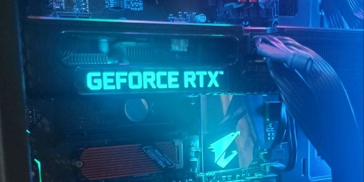
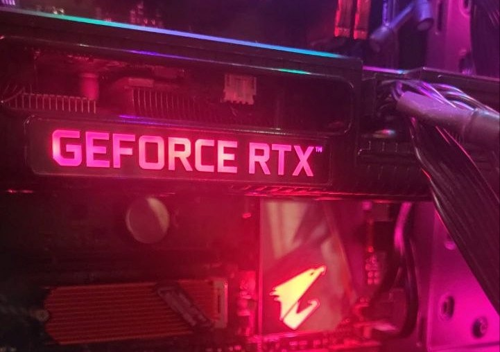
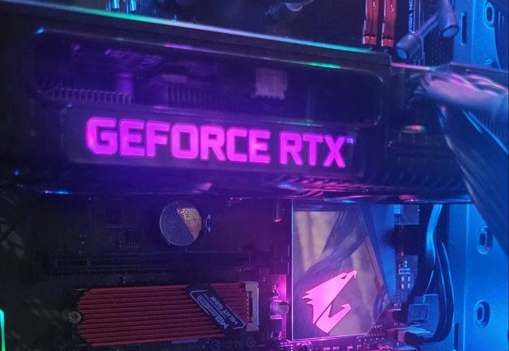

# AmbilightRGB

[English](README.md) | **Русский**

Фоновая подсветка в такт экрану на ~100 строках математики. Без ИИ. **5 FPS**, почти нулевая нагрузка, все устройства OpenRGB красятся каждый кадр.

Windows · Python 3.10+ · [OpenRGB](https://openrgb.org/) SDK · MIT

### Зачем это

Для фоновой подсветки в такт экрану **не нужен ИИ**. Даунсэмпл кадра, средний RGB с весом по насыщенности (белое / серое / чёрное отфильтровано) и экспоненциальное сглаживание на **5 FPS** дают синхронный glow при **~0% нагрузки на GPU** и минимальном следе в системе. OpenRGB рассылает один `RGBColor` на **все** устройства — материнскую плату, кулеры и видеокарту.

На пустых и ахроматических кадрах (загрузка, чёрная сцена, белый экран) цель плавно уходит в спокойный приглушённый синий, а не зависает на последнем случайном цвете. При обрыве сокета OpenRGB скрипт сам ждёт и переподключается.

### Hidden GPU RGB Unlock

На ряде видеокарт (например **Palit RTX 3060 Dual**) подсветка в фирменной утилите (**ThunderMaster**) и в **GUI OpenRGB** выглядит заблокированной: одноцветная белая / неуправляемая.

Прямой бродкаст через OpenRGB SDK — `device.set_color(...)` — разблокирует полноценный RGB. Скрипт по возможности включает режим `direct` и каждый кадр красит все устройства целиком.

#### Фото-пруфы

| Голубой / бирюзовый | Малиново-красный | Фиолетово-розовый |
| :---: | :---: | :---: |
|  |  |  |

### Требования

- Windows 10/11
- Python 3.10+
- Portable [OpenRGB](https://openrgb.org/) в `bin/OpenRGB/openrgb.exe`  
  *(или готовая сборка из **Releases** — бинарники OpenRGB в репозиторий не входят)*

### Быстрый старт

```bat
python -m venv .venv
.venv\Scripts\activate
pip install -r requirements.txt
start_ambilight.bat
```

Или напрямую (SDK-сервер OpenRGB уже должен слушать `127.0.0.1:6742`):

```bat
python ambilight.py
```

Тихий режим (без консоли): `ambilight.pyw` / `pythonw ambilight.pyw`.

**Самый первый запуск:** Windows **один раз** запросит права администратора, чтобы OpenRGB зарегистрировал драйвер SMBus (`WinRing0x64.sys`) для подсветки материнской платы. Все последующие запуски идут полностью в фоне **без** UAC.

`start_ambilight.bat` проверяет службу `WinRing0_1_2_0` и папку `%APPDATA%\OpenRGB`. При первом запуске поднимает `bin/OpenRGB/openrgb.exe` с повышением прав; дальше — `openrgb.exe --server --startminimized` с обычными правами.

### Структура

| Путь | Назначение |
| --- | --- |
| `ambilight.py` | Захват → фильтр chroma → EMA → бродкаст OpenRGB |
| `ambilight.pyw` | Тот же вход без консоли |
| `start_ambilight.bat` | Запуск в один клик + инициализация драйвера |
| `bin/OpenRGB/` | Portable OpenRGB (`openrgb.exe` — скачивается отдельно) |
| `docs/` | Фото-пруфы |
| `requirements.txt` | `openrgb-python`, `mss`, `numpy`, `Pillow` |

### Лицензия

MIT — файл [LICENSE](LICENSE).
